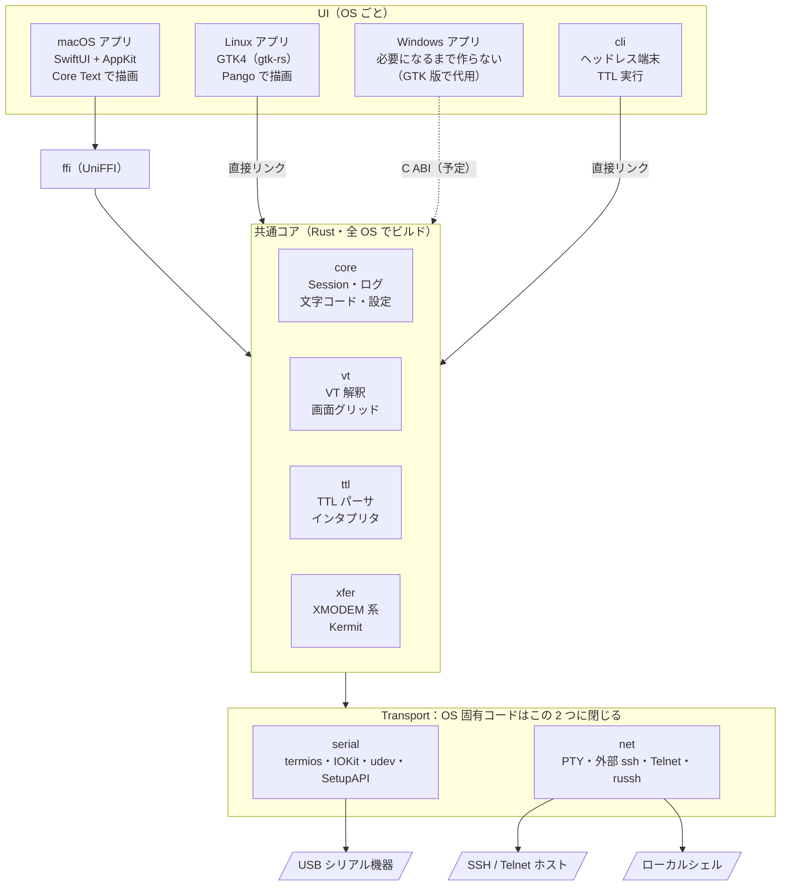

# Tera Term互換 マルチOS端末アプリ 設計書

Nov 5, 2026

## 概要とゴール

Tera Term の操作感を、Rust の共通コアと OS ごとのネイティブ UI で macOS・Linux・Windows に再現する。最初のターゲットは Apple Silicon の macOS。

ゴール

- シリアルコンソール端末として Tera Term と同じ手順・同じ設定項目で使える
- SSH / Telnet / ローカルシェルも同じ窓で扱える
- TTL マクロの頻出サブセットがそのまま動く（GUI とヘッドレス CLI の両方）
- Tera Term より良くする点：USB シリアルの押し引きで自動再接続、デバイスを製品名で選べる、ネイティブタブ、複数セッション一斉送信

非ゴール

- Tera Term の Win32 コードの移植（仕様と文言は参照するが、コードは書き直す）
- TTL 全コマンドの完全互換
- Electron 等の Web ベース UI
- 当面の App Store 配布（公証付き直接配布とする）

## 全体アーキテクチャ

UI だけを OS ごとに書き、接続・端末状態・マクロ・転送はすべて共通の Rust コアに置く。参考にしたのは Ghostty の構成（共通コア＋各 OS の薄い UI）。

**全体構成** · UI 4 種、共通コア 4 クレート、Transport 2 クレート（UI だけ OS ごとに書き、残りは共通 Rust コアに集める）



（元の設計書 Artifact の図をテキスト化したもの）

UI からは write や resize を下ろし、コアからは変更通知だけを上げる。Linux 版と cli はコアと同じ Rust なので FFI を通らず直接リンクする。

## クレート構成と責務

Cargo ワークスペース 1 つに Rust クレートを並べ、OS ごとの UI は `apps/` に置く。UI に依存するコードは `crates/` に入れない。

| パス | 責務 | 主な依存 | 対応 OS |
| --- | --- | --- | --- |
| `crates/core` | Session、Transport の抽象、文字コード・改行変換、ログ、プロファイル | tokio, encoding\_rs, serde | 全 OS |
| `crates/vt` | VT エミュレーション、画面グリッド、変更行の追跡、スクロールバック | alacritty\_terminal | 全 OS |
| `crates/serial` | ポート制御、任意ボーレート、デバイス列挙とホットプラグ、自動再接続 | serialport, IOKit / udev / SetupAPI（cfg 分岐） | 全 OS |
| `crates/net` | SSH（外部 ssh を PTY 起動 → 後で russh）、Telnet、ローカル PTY | portable-pty, russh | 全 OS |
| `crates/xfer` | XMODEM / YMODEM / ZMODEM / Kermit | — | 全 OS |
| `crates/ttl` | TTL パーサとインタプリタ、Session への send / wait | core | 全 OS |
| `crates/ffi` | UniFFI による公開 API、Swift バインディング生成 | uniffi | macOS（将来 Windows） |
| `crates/cli` | ヘッドレス端末と TTL 実行 | clap | 全 OS |
| `apps/macos` | SwiftUI + AppKit、ffi を XCFramework で取り込み | — | macOS |
| `apps/linux` | GTK4（gtk-rs）、core を直接利用 | gtk4 | Linux |
| `apps/windows` | 必要になるまで作らない（GTK 版で代用） | — | Windows（保留） |

共通ルール

- `crates/` 配下は GitHub Actions で macOS・Linux・Windows の 3 環境で `cargo test` を通す
- OS 固有コードは `serial` と `net` の中に閉じる。他のクレートに `cfg(target_os)` を書かない
- 設定ファイルは TOML。`TERATERM.INI` のインポートは `core` が持つ

## FFI 境界とデータフロー

受信バイトは UI に流さず、コアが画面状態まで作って「変更あり」だけ通知する。UI は次のフレームで変更行を取りに来るので、FFI の呼び出し回数はフレームレートで頭打ちになる。

```rust
pub trait SessionListener: Send + Sync {
    fn on_damage(&self);                  // 再描画が必要
    fn on_state(&self, s: SessionState);  // Connecting / Connected / Reconnecting / Closed
    fn on_bell(&self);
    fn on_title(&self, title: String);
}

pub trait DeviceListener: Send + Sync {
    fn on_devices_changed(&self, devices: Vec<SerialDevice>); // 抗き差し
}

impl Session {
    pub fn open(profile: Profile, l: Box<dyn SessionListener>) -> Result<Arc<Self>>;
    pub fn write(&self, bytes: Vec<u8>);
    pub fn paste(&self, text: String);        // 複数行確認と送信遅延はコア側
    pub fn resize(&self, cols: u16, rows: u16);
    pub fn snapshot(&self, since: u64) -> GridSnapshot; // 世代番号以降の変更行＋カーソル
    pub fn scrollback(&self, from: i64, rows: u16) -> Vec<Row>;
    pub fn send_break(&self, ms: u32);
    pub fn set_lines(&self, dtr: bool, rts: bool);
    pub fn log_start(&self, opts: LogOptions) -> Result<()>;
    pub fn close(&self);
}
```

スレッドモデル

- コアは内部に tokio ランタイムを 1 つ持ち、Transport の読み書きと VT 更新はそこで行う
- Listener はコアのスレッドから呼ばれる。UI 側は受けたらメインスレッドに移して再描画を予約するだけ
- `snapshot` はロックを短く握ってコピーを返す。UI は受け取った行だけ描き直す
- Mac は displayLink、Linux は GTK の frame clock で snapshot を取りに行く

描画は各 OS に残す。Mac は Core Text（将来 Metal）、Linux は Pango。日本語の字幅とフォントフォールバックを OS に任せるため。文字のセル幅（全角・半角、曖昧幅）の判定だけはコアが決めて snapshot に載せる。

後から足すデーモンモード（`termd`）は同じ API をローカルソケット上に載せる。UI を閉じてもセッションとログが生き続ける。既定はライブラリ直結。

## UI 構成：Tera Term から移植する範囲

コードは持ってこれないが、UI の仕様はほぼ丸ごと取れる。メニュー、ダイアログの項目、UI 文言、設定キーがすべてテキストリソースとして分離されているため。以下は [TeraTermProject/teraterm](https://github.com/TeraTermProject/teraterm) の main ブランチを確認した結果。

| 元ファイル | 中身 | 使い方 |
| --- | --- | --- |
| `teraterm/teraterm/ttermpro.rc` | メインメニュー（ファイル / 編集 / 設定 / コントロール / ウィンドウ / ヘルプ、約 70 項目）、アクセラレータ | メニュー構造をそのまま採用 |
| `teraterm/ttpdlg/ttpdlg.rc` | 端末・ウィンドウ・キーボード・TCP/IP・全般・新しい接続などのダイアログ | 項目と並び順を採用、配置は各 OS で組み直す |
| `teraterm/teraterm/*_pp.rc` | 詳細設定の各ページ（シリアル、文字コード、ログ、マウス、フォント、テーマ等 14 ページ） | 設定ウィンドウのタブ構成に対応させる |
| `installer/release/lang_utf8/*.lng` | UI 文言。ja\_JP で約 1,150 項目、10 言語 | ラベルをそのまま使う。Mac は String Catalog、Linux は gettext に変換 |
| `installer/release/TERATERM.INI` | 設定キーと既定値。\[Tera Term\] セクションだけで約 220 キー | 設定スキーマの下敷きと INI インポート |
| `teraterm/ttpmacro/ttmparse.*` | TTL の予約語約 230 | TTL コマンド表と実装状況の管理 |

抽出の仕方

- `tools/extract-tt-ui`（Rust か Python）で `.rc` と `.lng` をパースし、メニュー木・ダイアログのコントロール一覧・文言キーを JSON にする
- その JSON から各 OS の文言カタログと設定項目の定義を生成する。手で写き写さない
- `.rc` は文字コードが混在している（`ttermpro.rc` は Shift\_JIS、`ttpdlg.rc` は UTF-8）。抽出器で吸収する

持ってこないもの

- ダイアログの座標（Win32 のダイアログ単位）。各 OS の標準レイアウトで組み直す
- Windows 固有の項目：Cygwin 接続、デバイスマネージャープロパティ、管理者として実行
- 利用者がほぼいない項目：B-Plus、Quick-VAN、TEK ウィンドウ（必要になれば後で）
- TTL と本体の間の DDE 通信。本家はマクロが別プロセスで DDE 経由だが、こちらはコア API を直接呼ぶ

Mac での読み替え

- 「設定」メニューの各ダイアログは、設定ウィンドウ（Cmd+,）のタブにまとめる。対して「シリアルポート」だけは接続中に開くのでシートとしても出す
- Alt 系のショートカットは Cmd に置換（新しい接続 Cmd+N、切断 Cmd+W など）。Alt+C / Alt+V でのコピー・貼り付けは互換設定として残す
- シリアル設定の「新規オープン / クローズ＆新規オープン / 現在の接続を再設定」の使い分けはそのまま再現する。Tera Term 利用者が迷わないため

Tera Term のライセンスは 3 条項 BSD。文言や設定仕様を流用するので、`THIRD_PARTY.md` と About 画面に Tera Term Project の著作権表示を入れる。

## ロードマップ

Phase 1 を終えた時点で、Mac のシリアル端末として日常的に使える状態にする。それ以降は使いながら機能を足す。

**ロードマップ** · Phase 0〜5 と完了条件（Phase 1 が終わった時点でシリアル端末として毎日使える）

| Phase | 名前 | 中身 | 完了条件 |
| --- | --- | --- | --- |
| 0 | 雛形 | ワークスペース・CI（3 OS）／Mac でローカルシェルを表示 | 入力・リサイズ・スクロールが動く |
| **1** | **シリアル** | 接続ダイアログ・設定シート／ホットプラグ・自動再接続・ログ | **実機の USB シリアルで日常使用** |
| 2 | SSH / Telnet | 外部 ssh・Telnet・プロファイル／ネイティブタブ・一斉送信 | ssh_config がそのまま効く |
| 3 | 転送・文字コード | XMODEM / YMODEM / ZMODEM / Kermit／Shift_JIS・EUC-JP の送受信 | lrzsz と相互に転送できる |
| 4 | TTL・Linux | TTL 頻出サブセットと cli／GTK4 版の同等画面 | 既存マクロが Mac と Linux で動く |
| 5 | 配布 | 署名・公証・自動更新／Windows には `zetta` コマンドを配る | 公証済み dmg を配布 |

（元の設計書 Artifact の図をテキスト化したもの）

各 Phase は完了条件を満たすまで次に進まない。日程は置かず、順序だけを決めている。

### Windows の扱い（2026-11-07 決定）

Windows には Tera Term 本体があるので、ネイティブの Windows 版（`apps/windows`）は必要になるまで作らない。
- `crates/` の Windows 対応は続ける（GitHub Actions で `cargo test` を回す）
- `zetta` コマンド（TTL のヘッドレス実行）は Windows でも配る（`.github/workflows/release-cli.yml`）
- 画面が要るときは、まず GTK 版（`apps/linux`）を Windows でビルドして試す

### ネットワーク機器向けの追加予定（2026-11-06 追加）

シリアルコンソールから機器のファームウェアを入れ替える用途を重視する。マクロの転送コマンドは Phase 4 の TTL サブセットに含め、それ以外は Phase 4 の後、Phase 5 の前に入れた（2026-11-06。macOS と GTK の両方）。ドラッグ＆ドロップは Tera Term の選択肢（SCP / ファイル送信 / ファイル名の貼り付け）に、プロトコル転送と .ttl のマクロ実行を足した。

| 項目 | 今の状態 | 追加するもの | 時期 |
| --- | --- | --- | --- |
| マクロからファイル転送 | なし | TTL の `xmodemsend` / `xmodemrecv` / `ymodemsend` / `ymodemrecv` / `zmodemsend` / `zmodemrecv` / `kermitsend` / `kermitrecv` / `sendfile`（結果は `result`） | 済（Phase 4） |
| シリアルから XMODEM でファーム送信 | 動く（128 バイト CRC 固定、実機は未確認） | 128 / 1K とチェックサム / CRC の選択、XON/XOFF のまま転送するときの警告、実機（ROMMON など）での確認 | 済（実機での確認は未） |
| 進捗・速度・リトライ数 | ファイル名、転送済み / 全体、経過時間、バー | 速度、残り時間、累計リトライ数（`zetta_xfer::Progress` と ffi の `TransferProgress` に足す） | 済 |
| バイナリを改変せずに送信 | プロトコル転送と SCP は変換・遅延なしで送る | Tera Term の「ファイル送信」（プロトコルなし。バイナリ指定で文字コード・改行変換を通さない。テキストは行ごとの遅延つき） | 済 |
| ドラッグ＆ドロップ送信 | SCP ダイアログの中だけ | 端末ウィンドウへのドロップで送り方を選ぶダイアログ（`DLG_DANDD_*`：SCP / ファイル送信 / 各プロトコル / ファイル名の貼り付け） | 済 |

## Claude Code サブエージェント割り振り

メインセッションを設計判断と API 契約の持ち主にし、実装は書き込み範囲を重ねないサブエージェントに切る。サブエージェントは別コンテキストで動き、[さらにサブエージェントを呼べない](https://skills.cat/skills/choru-k/skills-for-ai/cc-dev-agents)ので、構造はメインから一段だけのフラットにする。定義は [`.claude/agents/<name>.md` に YAML フロントマター付きで置き](https://docs.claude.com/en/docs/claude-code/sub-agents)、リポジトリで共有する。

| エージェント | 書き込み範囲 | 主な仕事 | model | tools |
| --- | --- | --- | --- | --- |
| メインセッション | `Cargo.toml`、`crates/ffi` の公開 API、`CLAUDE.md`、設計書 | 設計判断、API 契約の確定、割り振り、統合 | opus | 全部 |
| `core-engine` | `crates/core`、`crates/vt` | Session、文字コード、ログ、VT グリッドと世代管理 | opus | Read, Edit, Write, Bash, Grep, Glob |
| `serial-io` | `crates/serial` | termios / IOKit / udev / SetupAPI、任意ボーレート、ホットプラグ、自動再接続 | opus | 同上 |
| `net-transport` | `crates/net` | PTY、外部 ssh 起動、Telnet、後で russh | sonnet | 同上 |
| `xfer-proto` | `crates/xfer` | XMODEM / YMODEM / ZMODEM / Kermit、仕様書ベースの実装とテスト | sonnet | 同上 |
| `ttl-runtime` | `crates/ttl` | TTL パーサとインタプリタ。本家ソースは参照のみ | sonnet | 同上 |
| `macos-ui` | `apps/macos` | SwiftUI + AppKit、端末ビュー、設定画面、メニュー | opus | 同上 |
| `linux-ui` | `apps/linux` | GTK4 版の同等画面 | sonnet | 同上 |
| `tt-spec` | `tools/extract-tt-ui`、`spec/` | `.rc` / `.lng` / INI から JSON を生成、文言カタログ出力 | haiku | 同上 |
| `reviewer` | なし（読み取り専用） | 境界ルール違反、unsafe、スレッド安全、API 契約とのずれを指摘 | opus | Read, Grep, Glob, Bash |
| `test-runner` | なし（読み取り専用） | `cargo test` / `clippy` / `xcodebuild test` を回し、失敗だけ要約して返す | haiku | Read, Grep, Glob, Bash |

model の振り分けの考え方

- opus：並行性、OS 固有 API、UI の細部など、誤ると後で高くつく部分。reviewer もここ
- sonnet：仕様が決まっていてテストで正しさを担保できる部分（転送プロトコル、TTL、Linux UI）
- haiku：出力が長く判断が少ない作業。テストログをメインに持ち込まないための防波堤も兼ねる

運用ルール

1. 契約が先、実装が後。メインが trait と型のシグネチャを先にコミットし、各エージェントはその裏側だけを実装する
2. 書き込み範囲は表の通り。範囲外の変更が必要になったら自分で直さず、要求としてメインに返す
3. 並列に走らせるのは範囲が重ならない組み合わせだけ。数日かかるレーンは git worktree ごとに別セッションで回す
4. UI 系はモック Transport（受信データをファイルから流す）に対して開発し、実機なしで進められるようにする。シリアルの結合テストは socat の仮想ポート対を使う
5. 各エージェントの返答は「変更ファイル、追加したテスト、未解決事項」を 10 行以内。メインのコンテキストを温存するため
6. 実装系エージェントの後は必ず `reviewer` → `test-runner` の順で通す

Phase 1 での並列の例：メインが Transport と DeviceListener の契約を確定 → `serial-io` と `macos-ui`（シリアル設定画面と接続ダイアログ）と `tt-spec`（シリアル関連の文言と設定キー）を同時に走らせる → メインが統合 → `reviewer` → `test-runner`。

定義ファイルの例：

```markdown
---
name: serial-io
description: crates/serial の実装担当。シリアルポート制御、デバイス列挙、ホットプラグ、自動再接続の変更時に使う。
tools: Read, Edit, Write, Bash, Grep, Glob
model: opus
---

担当は crates/serial のみ。他のパスは編集しない。
契約は crates/core/src/transport.rs の Transport と DeviceListener。シグネチャは変えない。

守ること
- OS 分岐は cfg(target_os) でこのクレート内に閉じる
- macOS の任意ボーレートは IOSSIOSPEED、Linux は termios2 / BOTHER
- テストは socat の仮想ポート対で書く。実機が必要なテストは #[ignore]

返答は「変更ファイル / 追加テスト / 未解決事項」を 10 行以内で。
```

## 未決事項

- [ ] アプリ名とリポジトリ名
- [x] ライセンス → MIT OR Apache-2.0 のデュアル（`LICENSE-MIT`、`LICENSE-APACHE`。2026-11-09）
- [ ] macOS の最低対応バージョン（最新のみに絞るか）
- [ ] VT エンジン：alacritty\_terminal で確定するか、libghostty-vt の API 安定を待つか
- [x] SSH をいつ純 Rust（russh）に切り替えるか → Phase 2 で切り替えた（2026-11-06）。TTSSH と同じく認証はダイアログ。ssh_config の対応外の項目が要る接続のため、システムの ssh も選べるようにしてある
- [ ] TTL サブセットの範囲。ネットワーク機器の操作で使うものから入れた（[ttl.md](ttl.md)）。既存マクロで足りないコマンドを洗い出して足す
- [ ] 設定の保存形式：TOML で確定するか、TERATERM.INI との双方向互換までやるか
